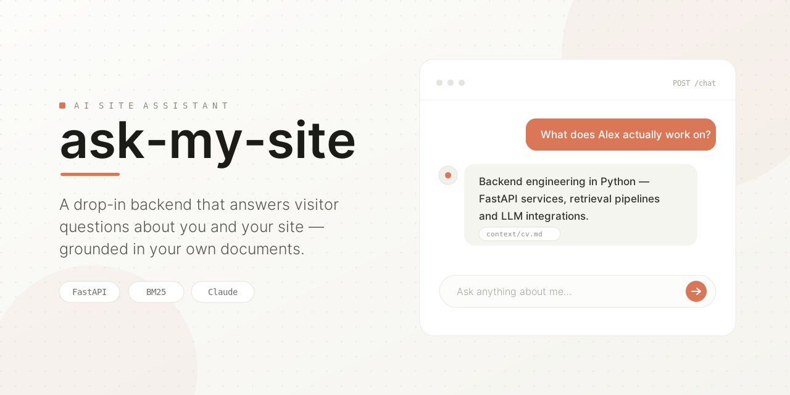

# ask-my-site



A reusable backend for a website AI assistant: a small HTTP API, callable from any frontend,
that answers visitor questions using **two sources of context** —

1. **The site's own persona** (`config/site.yaml`): who it's speaking for, in a few
   sentences you write once.
2. **Whatever documents you drop into `context/`** (Markdown/text): CV content, project
   write-ups, FAQs, anything else the assistant should know about.

**Status: template / draft scaffold.** This repo is meant to be cloned (or its `src/` reused)
per deployment, not run as-is against real traffic yet — see "Open items" below.

## How this becomes *your* assistant

1. `cp config/site.example.yaml config/site.yaml` and fill in your name, role, a short
   "about" blurb, and links. This is the assistant's fixed identity — it doesn't change
   per question.
2. Drop `.md`/`.txt` files into `context/` (subdirectories are fine) — anything you want
   the assistant to be able to answer questions about. Both `config/site.yaml` and
   `context/*` are gitignored, so a deployment's real content never has to live in this repo.
3. `cp .env.example .env`, set `ANTHROPIC_API_KEY`, and set `ALLOWED_ORIGINS` to the
   origin(s) of the site(s) that will call this API from the browser.
4. Run it (see "Running locally" / "Running in Docker" below) and point your frontend's
   chat widget at `POST /chat`.

## How a question gets answered

```
POST /chat  { "message": "...", "history": [...] }
        │
        ▼
BM25Retriever.search(message)   # top-k chunks from context/, ranked by keyword overlap
        │
        ▼
build_system_prompt(site_config, chunks)   # persona + retrieved chunks -> one system prompt
        │
        ▼
ClaudeAssistant.reply(system_prompt, history, message)   # single call to the Anthropic API
        │
        ▼
{ "reply": "..." }
```

Retrieval is lexical (BM25 over keyword overlap, via `rank-bm25`), not embedding-based —
deliberately, the same call made in `custom-llm-finetuning`: for the handful of documents a
personal or small-business site's assistant realistically needs, BM25 needs no model
download and no vector store, and is good enough. `src/domain/retriever.py`'s `Retriever`
interface exists so an embedding-based implementation can be swapped in later, behind the
same `index()`/`search()` contract, if the context ever grows large enough for that to matter.

## Structure

```
config/site.example.yaml  # Template for config/site.yaml (gitignored) - the assistant's persona
context/.gitkeep          # context/*.md and context/*.txt (gitignored) get indexed at startup
app.py                     # create_app(): wires settings + site config + retriever + LLM client;
                           # also the uvicorn entrypoint
src/
  controllers/
    chat_controller.py    # GET /health, POST /chat - HTTP layer only
  domain/
    models/
      entities.py         # SiteConfig, ChatTurn, Chunk, ChatRequest, ChatResponse
    persona.py             # build_system_prompt(): persona + retrieved chunks -> system prompt
    retriever.py           # Retriever interface
    chat_store.py           # ChatStore interface
    repositories/
      chat_repository.py  # business logic: retrieval + prompt assembly + the LLM call + save
  infrastructure/
    settings.py            # Settings: env vars (ANTHROPIC_API_KEY, ALLOWED_ORIGINS, etc.)
    site_config_loader.py  # load_site_config(): reads config/site.yaml
    context_loader.py      # load_context_documents(): reads context/ into Chunks
    bm25_retriever.py      # BM25Retriever: the default Retriever implementation
    llm_client.py          # ClaudeAssistant: the only module that calls the Anthropic API
    firestore_chat_store.py # FirestoreChatStore: saves each exchange to Firestore
    null_chat_store.py      # NullChatStore: no-op, used when SAVE_CONVERSATIONS is off
    logging_config.py      # configure_logging()
  service_layer/
    chat_service.py        # thin orchestration: unpacks the request, packs the response
tests/               # Unit tests - no live network calls (ClaudeAssistant is stubbed
                     # out in test_routes.py; nothing else touches the network)
Dockerfile           # uv-managed image; config/ and context/ are usually bind-mounted
                     # in at runtime instead of baked in (see `make docker-run`)
```

Layered architecture: `controllers` (HTTP) call `service_layer` (unpack/pack request-response
DTOs), which calls `domain/repositories` (business logic - retrieval, prompt assembly),
which calls `infrastructure` (external I/O - the Anthropic API, the filesystem, env vars).
`domain/models` and `domain/retriever.py` hold the shared data shapes and interfaces every
layer depends on.

## Running locally (without Docker)

Environment is managed with [uv](https://docs.astral.sh/uv/) — `pyproject.toml` + `uv.lock`
are the source of truth, no `requirements*.txt`. This isn't an installed package (see
`[tool.uv] package = false` in `pyproject.toml`) — `app.py` lives at the repo root and `src/`
is a regular package (`src/__init__.py`), so both `uvicorn app:create_app` and `pytest` work
from the repo root with no `PYTHONPATH` juggling (pytest gets it from
`[tool.pytest.ini_options]` instead).

```bash
make install     # uv sync: creates .venv, installs runtime + dev deps from uv.lock
make test        # uv run pytest
make lint         # uv run ruff check .

cp config/site.example.yaml config/site.yaml   # then fill it in
cp .env.example .env                            # then set ANTHROPIC_API_KEY

make dev         # uvicorn with --reload, http://localhost:8000
make run         # same, without --reload (respects $PORT)
```

`GET /health` returns `{"status": "ok"}`. `POST /chat` expects
`{"message": "...", "history": [{"role": "user" | "assistant", "content": "..."}], "session_id": "..."}`
(`session_id` is optional) and returns `{"reply": "...", "session_id": "..."}` - if the
request didn't include one, the response carries the one the server minted so the caller can
resend it on the conversation's later turns (see "Persisting conversations" below).

## Running in Docker

```bash
make build        # docker build -t ask-my-site .
make docker-run   # builds, then runs with config/ and context/ mounted read-only,
                   # and .env loaded via --env-file
```

`config/` and `context/` are bind-mounted rather than baked into the image so a deployment
can update its persona or documents without a rebuild — the `COPY config/ context/` lines in
the `Dockerfile` just mean the image also works standalone (e.g. `docker run` without the
mounts) with whatever was in the repo at build time.

## Deploying to Cloud Run

`deploy.sh` (`make deploy`) deploys straight from source with
[`gcloud run deploy --source=.`](https://cloud.google.com/run) — Cloud Build builds the
`Dockerfile` and pushes it for you, no manual `docker push` or Artifact Registry setup
needed. `config/site.yaml` and `context/` get baked into the image at build time (Cloud Run
has no bind mounts), so both need to exist and be filled in locally before deploying.

`GCP_PROJECT_ID` and `ALLOWED_ORIGINS` come from `.env` — `deploy.sh` refuses to run if
either is missing there, so a deploy never silently goes out under the wrong project or the
wrong CORS origin (CORS matches on `scheme://host[:port]` only, so `/projects` and `/contact`
are covered automatically once the origin is right - no need to list them separately).
`GCP_REGION`, `SERVICE_NAME`, and `SECRET_NAME` have defaults (see the comment block at the
top of `deploy.sh`) but can be overridden the same way, either in `.env` or ad hoc:

```bash
GCP_REGION=europe-southwest1 make deploy
```

One-time setup:

```bash
cp .env.example .env   # then fill in ANTHROPIC_API_KEY, GCP_PROJECT_ID, ALLOWED_ORIGINS
gcloud auth login
gcloud config set project "$(grep GCP_PROJECT_ID .env | cut -d= -f2)"

gcloud services enable run.googleapis.com cloudbuild.googleapis.com \
  artifactregistry.googleapis.com secretmanager.googleapis.com \
  --project="$(grep GCP_PROJECT_ID .env | cut -d= -f2)"

# ANTHROPIC_API_KEY is injected from Secret Manager, not passed as a plain env var, so it
# never shows up in `gcloud run services describe` or the Cloud Run console.
export $(grep ANTHROPIC_API_KEY .env)
printf '%s' "$ANTHROPIC_API_KEY" | gcloud secrets create ask-my-site-anthropic-api-key \
  --project="$(grep GCP_PROJECT_ID .env | cut -d= -f2)" --data-file=-
```

Then, any time you want to (re)deploy:

```bash
cp config/site.example.yaml config/site.yaml   # first time only - then fill it in
make deploy
```

The script prints the service's public URL once the deploy finishes.

## Calling it from a website

CORS is enabled via `ALLOWED_ORIGINS` (comma-separated in `.env`), so a browser-side chat
widget on an allowed origin can call `POST /chat` directly:

```js
// Reuse the same session_id for every message in one conversation so persisted
// transcripts (see "Persisting conversations" below) land in a single Firestore document.
let sessionId = sessionStorage.getItem("ask-my-site-session-id");

const response = await fetch("https://your-ask-my-site-deployment/chat", {
  method: "POST",
  headers: { "Content-Type": "application/json" },
  body: JSON.stringify({
    message: "What projects have you built?",
    history: [],
    session_id: sessionId,
  }),
});
const { reply, session_id } = await response.json();
sessionStorage.setItem("ask-my-site-session-id", session_id);
```

No frontend widget ships in this repo yet — see Open items.

## Persisting conversations

The API itself stays stateless — `history` is still passed in by the caller on every
request — but when `SAVE_CONVERSATIONS=true`, `ChatRepository` upserts one Firestore
document per conversation, keyed by `session_id`, right after the Claude call succeeds. Each
save replaces the document's `history` field with the full transcript so far (the incoming
history plus the new message/reply) and bumps `updated_at`; `created_at` is set once, on the
first turn. A conversation therefore lives in a single, growing document instead of one new
document per turn — much easier to read in the Firestore console or query later. Writes go
to the collection named by `CHAT_STORE_COLLECTION` (default `conversations`).
`FirestoreChatStore` swallows and logs write failures rather than raising, so a Firestore
outage never breaks the chat feature itself.

`session_id` is optional on the request - the server mints a `uuid4` and returns it if the
caller doesn't send one - but a caller has to actually resend the same id on every message
for this to pay off; otherwise each request mints (and persists under) a fresh one. See
"Calling it from a website" above for the pattern (store it in `sessionStorage`, send it back
on every call).

One-time setup, in addition to the APIs enabled above:

```bash
gcloud services enable firestore.googleapis.com --project="$GCP_PROJECT_ID"

# Native mode, once per project - skip if a Firestore database already exists.
gcloud firestore databases create --project="$GCP_PROJECT_ID" --location="$GCP_REGION"

# Lets the Cloud Run service account read/write Firestore.
PROJECT_NUMBER="$(gcloud projects describe "$GCP_PROJECT_ID" --format='value(projectNumber)')"
gcloud projects add-iam-policy-binding "$GCP_PROJECT_ID" \
  --member="serviceAccount:${PROJECT_NUMBER}-compute@developer.gserviceaccount.com" \
  --role="roles/datastore.user"
```

Then set `SAVE_CONVERSATIONS=true` in `.env` before `make deploy` (or export it ad hoc, same
as `GCP_REGION` above). Locally, it also needs credentials Firestore can use —
`gcloud auth application-default login` — so it's left off by default for local dev.

## Open items before this goes beyond a local draft

1. **No frontend widget.** Any site calling this today has to write its own `fetch` call and
   chat UI against `POST /chat` — a small embeddable widget (script tag, like GoatCounter's)
   would make this a genuine drop-in template.
2. **Only `.md`/`.txt` are ingested.** PDFs (a CV export, say) need a text-extraction step
   added to `src/infrastructure/context_loader.py` before they're usable as context.
3. **No rate limiting or abuse protection** on `POST /chat` — a public endpoint that spends
   API credits per call needs this before it's pointed at real traffic.
4. **Single, non-streaming Claude call.** `ClaudeAssistant.reply()` waits for the full
   response before returning; streaming would improve perceived latency for longer answers.
5. **BM25 retrieval, not embeddings** — see "How a question gets answered" above. Revisit if
   `context/` grows past what keyword overlap can rank well.
